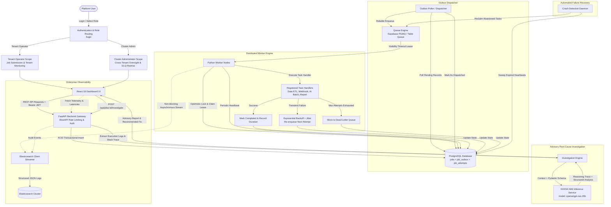

# TaskForge
### Intelligent Asynchronous Job Orchestration Platform
> *"Submit once. Process reliably. Recover intelligently."*

TaskForge is a production-grade distributed job orchestration and background execution engine engineered for mission-critical workflows. Designed with at-least-once delivery semantics, transactional outbox durability, optimistic concurrency control, bounded exponential backoff with full jitter, dead-letter redrive, structured Elasticsearch streaming observability, and advisory AI-assisted root cause analysis powered by **NVIDIA NIM** (`openai/gpt-oss-20b`).

---

## 🏛️ System Architecture & Workflow

The architecture decouples job submission from distributed execution to guarantee zero data loss during network partitions, worker crashes, or broker restarts.



---

## ✨ Core Platform Capabilities

### 1. Reliable Asynchronous Job Orchestration
- **Transactional Outbox Pattern:** Job records and outbox dispatch intents are atomically committed within a single PostgreSQL ACID transaction, preventing dual-write inconsistencies.
- **At-Least-Once Delivery & Visibility Leases:** Workers acquire time-bounded visibility leases. If a worker terminates unexpectedly, its lease expires and the task automatically becomes available for recovery.
- **Exponential Backoff with Full Jitter:** Failed attempts are rescheduled using Decorrelated / Full Jitter exponential backoff:
  $$\Delta t = \min(t_{\text{max}},\, t_{\text{base}} \times 2^{\text{attempt}} + \text{rand}(0, \text{jitter}))$$
  preventing thundering herd problems on downstream services.
- **Dead-Letter Queue (DLQ) & Redrive:** Jobs exceeding maximum retry thresholds transition to `dead_letter` status with full stack traces, awaiting administrative redrive or root cause diagnosis.

### 2. Multi-Tenant Role-Based Access Control (RBAC)
- **Dedicated Authentication Gateway:** Modern login portal (`/login`) featuring role-based redirection, pre-configured operator and cluster administrator credentials, and visual role verification.
- **Tenant Operator:**
  - Strict tenant-scoped data isolation (`tenant_id` filtering on all queries).
  - Submit jobs, observe progress, inspect attempt histories, and trigger advisory root cause analysis.
- **Cluster Administrator:**
  - Full cross-tenant cluster visibility.
  - Interactive dead-letter queue redrive (bulk or single-job).
  - Manual job abort/cancellation for runaway or misbehaving processes.
  - Cluster-wide worker health and resource metrics.

### 3. AI-Assisted Root Cause Investigation (NVIDIA NIM)
- **Direct NVIDIA NIM Integration:** Connects to NVIDIA's high-performance inference API (`https://integrate.api.nvidia.com/v1`) using the model `openai/gpt-oss-20b`.
- **Reasoning Extraction:** Inspects and logs `reasoning_content` generated by the model during chain-of-thought analysis.
- **Structured Schema Enforcement:** Generates strict Pydantic-validated `InvestigationReport` schemas with:
  - Concise root cause classification (`infrastructure`, `transient_network`, `payload_validation`, `code_defect`).
  - Extracted log evidence snippets.
  - Actionable remediation suggestions.
  - Recommended retry decision (`safe_to_retry: true/false`).
- **Grounded & Resilient:** Backed by deterministic log analysis fallback ensuring operators receive actionable insights even when external AI endpoints are unreachable.

### 4. Enterprise Observability & Telemetry
- **Decoupled Elasticsearch Streamer:** Structured JSON logs and execution events are published via a non-blocking queue to prevent logging overhead from impacting task throughput.
- **Real-Time Operational Metrics:** Computes P50, P90, P95, and P99 execution latencies, throughput rates, and per-status breakdowns.
- **Interactive Timeline & Audit Trail:** Interactive modal showcasing state transitions, attempt history, and log records.

---

## 🛠️ Technology Stack

| Domain | Technologies |
|---|---|
| **Frontend** | React 19, TypeScript, Vite, Tailwind CSS, Lucide Icons, Recharts |
| **Backend Gateway** | Python 3.11+, FastAPI, Pydantic v2, SlowAPI Rate Limiting |
| **Persistence** | PostgreSQL (Supabase / Standard), SQLAlchemy 2.0 Async, Alembic |
| **Queue Engine** | Supabase Queues (`pgmq`) with transactional table-queue fallback |
| **AI Inference** | NVIDIA NIM API (`openai/gpt-oss-20b`), OpenAI SDK, CrewAI |
| **Observability** | Elasticsearch async event streamer, structured JSON telemetry |
| **Testing** | Pytest, pytest-asyncio, HTTPX ASGI client |

---

## 📂 Repository Structure

```
TaskForge/
├── backend/
│   ├── app/
│   │   ├── ai/             # NVIDIA NIM & CrewAI failure investigation engine
│   │   ├── api/v1/         # Versioned REST controllers (jobs, admin, metrics, health)
│   │   ├── core/           # Configuration, security, JWT auth, database engine
│   │   ├── models/         # SQLAlchemy ORM models (Job, Attempt, Event, Outbox)
│   │   ├── schemas/        # Pydantic v2 validation models
│   │   ├── services/       # Job lifecycle, outbox dispatcher, recovery services
│   │   ├── workers/        # Worker engine, lease manager, registered task handlers
│   │   ├── queue/          # Supabase PGMQ and fallback table queue adapters
│   │   └── observability/  # Elasticsearch client and event publisher
│   ├── tests/              # Comprehensive test suite (46+ unit, integration, & security tests)
│   └── pyproject.toml
├── frontend/
│   ├── src/
│   │   ├── components/     # UI components (AdminControlCenter, JobExplorer, MetricsOverview, etc.)
│   │   ├── pages/          # LoginPage, DashboardPage
│   │   ├── context/        # AuthContext with tenant and admin claims
│   │   ├── hooks/          # Data polling and API interaction hooks
│   │   ├── lib/            # Axios API client and Supabase bindings
│   │   └── types/          # TypeScript interface definitions
│   ├── package.json
│   └── vite.config.ts
├── migrations/             # Database schema migrations
├── .env.example            # Environment configuration template
└── README.md
```

---

## 🚀 Getting Started

### 1. Environment Setup
Copy the environment template and configure database and AI inference credentials:
```bash
cp .env.example .env
```

Key environment settings in `.env`:
```env
# Database & Auth
SUPABASE_URL=https://<your-project>.supabase.co
SUPABASE_DB_URL=postgresql+asyncpg://<user>:<password>@<host>:6543/postgres?ssl=require

# NVIDIA NIM LLM Integration
LLM_PROVIDER=nvidia
LLM_BASE_URL=https://integrate.api.nvidia.com/v1
LLM_MODEL=openai/gpt-oss-20b
LLM_API_KEY=nvapi-<your-nvidia-api-key>
```

### 2. Start the Backend API & Worker Engine
```bash
cd backend
python -m uvicorn app.main:app --reload --port 8080
```
- Interactive Swagger UI: `http://localhost:8080/docs`
- Health check probe: `http://localhost:8080/api/health`

### 3. Start the Frontend Application
```bash
cd frontend
npm install
npm run dev
```
Open `http://localhost:5173` in your browser.

---

## 🧪 Testing & Verification

Run the automated test suite across all subsystems:
```bash
cd backend
python -m pytest tests -v
```

The test suite validates:
- Rate limiting and role-based permissions (Operator vs Admin).
- Transactional outbox dispatch and at-least-once delivery guarantees.
- Worker lease expiration and crash recovery sweeps.
- Dead-letter queue transitions and administrative redrive.
- NVIDIA NIM AI failure investigation and schema compliance.
- Injection resistance, malformed payloads, and poison pill isolation.

---

## 🎮 Pre-Configured Demonstration Accounts

TaskForge provides two built-in demonstration profiles on the login page (`http://localhost:5173/login`):

1. **Tenant Operator (`operator@taskforge.dev`):**
   - Scoped to `tenant-acme-corp`.
   - Submit new background jobs and inspect execution timeline.
   - Run AI-assisted root cause analysis on failed jobs.
2. **Cluster Administrator (`admin@taskforge.dev`):**
   - Platform-wide scope across all tenants.
   - Access to the **Cluster Control Center**.
   - Redrive failed tasks from the Dead-Letter Queue.
   - Force-cancel pending or running jobs.

---

## 📄 License
TaskForge is open-source software licensed under the [Apache 2.0 License](LICENSE).
