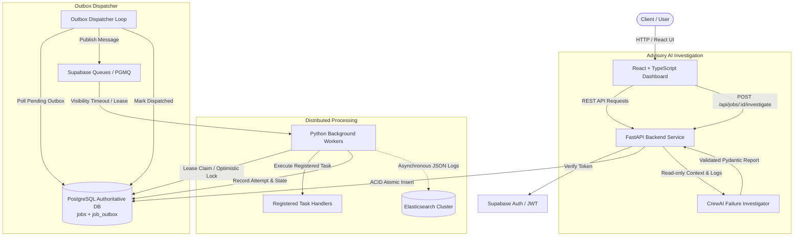

# TaskForge
### Intelligent Asynchronous Job Orchestration Platform
> *"Submit once. Process reliably. Recover intelligently."*

TaskForge is a production-minded cloud computing platform built to orchestrate, execute, monitor, and recover background jobs with at-least-once delivery semantics, bounded exponential backoff with jitter, dead-letter recovery, structured Elasticsearch observability, and advisory CrewAI failure investigation.

---

## 🏛️ System Architecture



---

## 🛠️ Technology Stack

- **Frontend:** React 19, TypeScript, Vite, Tailwind CSS, Lucide Icons, Recharts.
- **Backend:** Python 3.11+, FastAPI, Pydantic v2, Pydantic Settings, SQLAlchemy (asyncpg / psycopg).
- **Database:** Supabase PostgreSQL (or standard PostgreSQL 16+).
- **Queue Engine:** Supabase Queues (`pgmq`) with outbox table-queue fallback.
- **Observability:** Structured JSON logging, non-blocking Elasticsearch index streamer.
- **AI Investigation:** CrewAI with Pydantic guardrails and deterministic test mock provider.
- **Testing:** Pytest, pytest-asyncio, HTTPX ASGI client.

---

## 📂 Repository Structure

```
TaskForge/
├── backend/
│   ├── app/
│   │   ├── api/v1/         # Versioned REST route controllers
│   │   ├── core/           # Configuration, logging, lifecycle
│   │   ├── models/         # SQLAlchemy ORM models
│   │   ├── schemas/        # Pydantic input/output schemas
│   │   ├── services/       # Core business & outbox dispatch logic
│   │   ├── workers/        # Worker engine, lease manager, handlers
│   │   ├── queue/          # Supabase pgmq and table queue adapters
│   │   ├── observability/  # Elasticsearch client and event publisher
│   │   └── ai/             # CrewAI failure investigator
│   ├── tests/              # Automated pytest suite
│   ├── Dockerfile
│   └── pyproject.toml
├── frontend/
│   ├── src/
│   │   ├── components/     # Reusable UI widgets
│   │   ├── pages/          # Dashboard, Explorer, Details, Settings
│   │   ├── layouts/        # Shell layout and headers
│   │   ├── hooks/          # Custom data-fetching hooks
│   │   ├── lib/            # API & Supabase client utilities
│   │   └── types/          # TypeScript interfaces
│   ├── Dockerfile
│   └── package.json
├── migrations/             # Alembic / SQL database migrations
├── docker-compose.yml      # Local container orchestration
├── .env.example            # Documented environment template
└── README.md
```

---

## 🚀 Getting Started

### 1. Environment Configuration
Copy `.env.example` to `.env`:
```bash
cp .env.example .env
```

### 2. Running the Backend
From the root directory:
```bash
cd backend
python -m uvicorn app.main:app --reload --port 8000
```
- Interactive Swagger UI: `http://localhost:8000/docs`
- Health probe: `http://localhost:8000/api/health`

### 3. Running Backend Tests
```bash
cd backend
python -m pytest tests -v
```

### 4. Running the Frontend
From the root directory:
```bash
cd frontend
npm install
npm run dev
```
Open `http://localhost:5173` in your browser.

---

## 📋 Implementation Roadmap Status

- [x] **Phase 0:** Repository Assessment, Architecture Decisions, & Planning
- [x] **Phase 1:** Project Foundation (Backend FastAPI + Frontend React/TS/Tailwind)
- [x] **Phase 2:** Database & Data Model (Migrations, Jobs, Attempts, Events, Outbox)
- [x] **Phase 3:** Authentication & Authorization (Supabase Auth, JWT verification, SlowAPI Rate Limiting)
- [x] **Phase 4:** Core Job Management API (Submission, Listing, Filtering, Idempotency)
- [x] **Phase 5:** Queue & Outbox Dispatcher (PGMQ / Table Queue, At-Least-Once Delivery)
- [x] **Phase 6:** Python Worker Engine (Handler Registry, Leases, Attempt Lifecycle)
- [x] **Phase 7:** Reliability & Recovery (Backoff Jitter, Heartbeats, Abandoned Recovery)
- [x] **Phase 8:** Frontend Operations Dashboard (Metrics, Explorer, Timeline, Submission)
- [x] **Phase 9:** Elasticsearch Observability (Decoupled JSON Streamer, Search)
- [x] **Phase 10:** CrewAI Failure Investigator (Advisory Agent, Schema Guardrails)
- [x] **Phase 11:** Metrics & Live Updates (Aggregations, P95/P99 latency)
- [x] **Phase 12:** Rigorous Testing & Security Review (Chaos, Poison Pills, Injections)
- [x] **Phase 13:** Cloud Deployment Readiness (Docker Compose, Nginx, GitHub Actions CI)
- [x] **Phase 14:** Reproducible Demonstration & Operator Runbook ([`DEMO_RUNBOOK.md`](file:///DEMO_RUNBOOK.md))

---

## 🎮 Demonstration & Verification Runbook

A complete walkthrough for architects and evaluators is provided in [**`DEMO_RUNBOOK.md`**](DEMO_RUNBOOK.md).

To run the automated console demonstration:
```bash
python scripts/demo_runner.py
```
